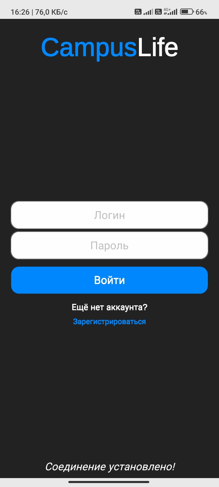
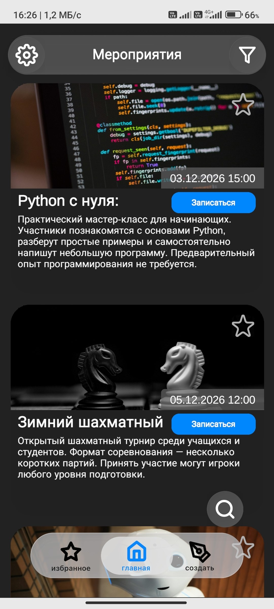
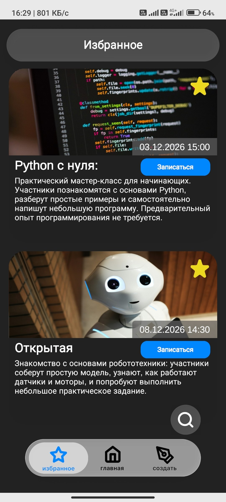
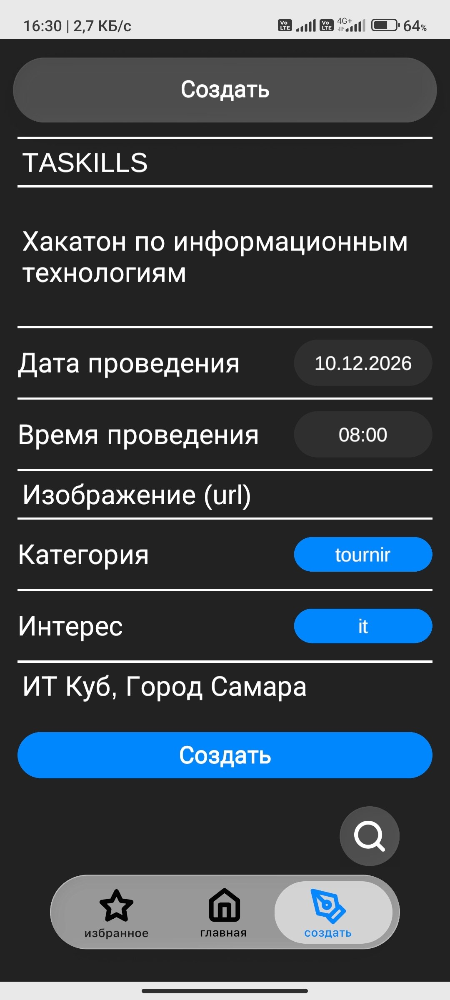
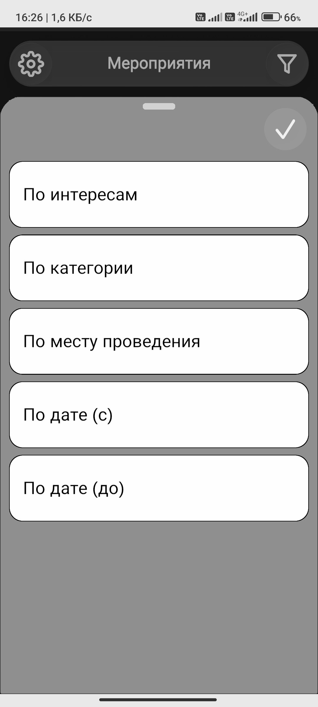
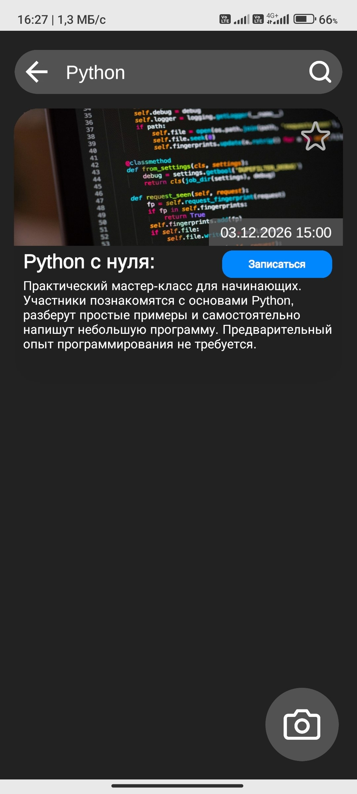
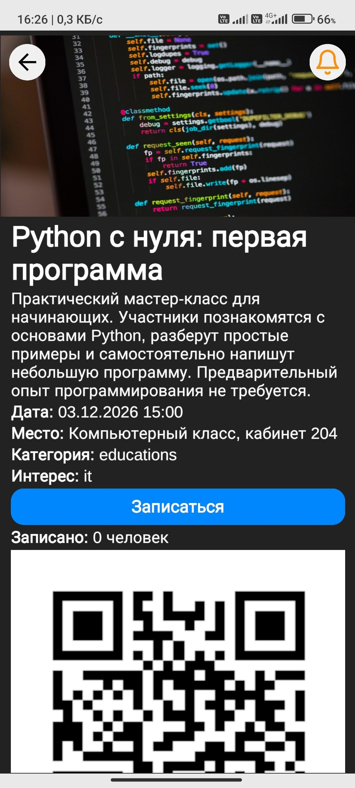
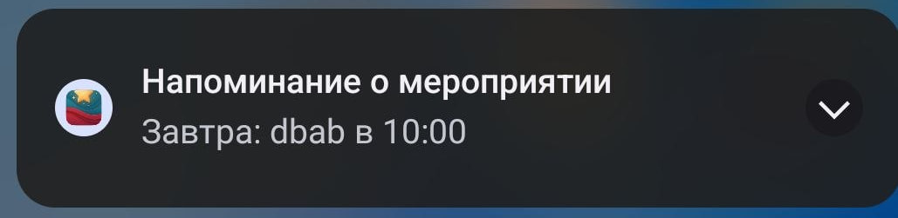

# 📱 CampusLife — Мобильная афиша школьных мероприятий

**Команда:** `wiNNers`  
**Трек:** Мобильная разработка

---

## 🎯 О проекте и проблематика

Ученики часто пропускают интересные мероприятия, кружки и школьные конкурсы из-за того, что информация разбросана по разным чатам, бумажным объявлениям и сайтам. Часть анонсов теряется, в результате чего школьное сообщество хуже вовлекается в жизнь школы, а организаторы недополучают участников.

**CampusLife** решает эту проблему: это единая мобильная афиша для школьного сообщества, где все события собраны в одном месте, удобно структурированы по интересам и датам, а встроенные функции записи и напоминаний помогают не пропустить ничего важного.

---

## ✨ Основной функционал

Приложение включает в себя следующие ключевые разделы и возможности:

### 1. 📰 Лента мероприятий
* Удобный список всех актуальных школьных событий.
* Карточка предпросмотра содержит фотографию, название, краткое описание, дату и время проведения.
* Возможность открыть детальную страницу мероприятия для ознакомления с подробной информацией.

### 2. 🔍 Фильтрация и поиск
* Фильтрация событий по категориям и интересам (например: *спорт, творчество, наука, конкурсы*).
* Фильтрация мероприятий по датам.
* Быстрый поиск нужного события по названию.

### 3. 📝 Запись на мероприятие
* Регистрация на выбранное событие в один клик.
* Личный список записей пользователя («Мои мероприятия»).
* Счётчик количества записавшихся участников (полезно для организаторов).

### 4. ⭐️ Избранное и напоминания
* Возможность сохранять интересные события в раздел «Избранное».
* Настройка уведомлений и напоминаний о приближении выбранного мероприятия.

---

## 🚀 Дополнительные возможности (Функционал для организаторов)

* **Создание событий:** встроенная форма для организаторов, позволяющая добавлять новые мероприятия прямо из приложения.
* **QR-регистрация:** генерация уникального QR-кода для события, с помощью которого участники могут быстро зарегистрироваться заранее или отметиться непосредственно на месте проведения.
> ❗Чтобы использовать права администратора необходимо залогиниться в аккаунт: `admin`, пароль: `test123`

---

## 🛠 Стек технологий

* **Платформа:** Android 7.0+
* **Язык программирования:** C#
* **Движок:** Unity
* **Бэкенд и БД:** Firebase
* **Работа с QR-кодами:** ZXing

---

## ⚙️ Установка и запуск

1. Скачайте файл:
   `winners_campuslife_setup.apk`
2. Установите приложение на Android устройство (Android 7.0+)
3. Запустите приложение

---

## 📸 Скриншоты

| Логин | Главная | Избранное | Создание | Фильтры | Поиск | Подробная информация | Push уведомление |
| :---: | :---: | :---: | :---: | :---: | :---: | :---: | :---: |
|  |  |  |  |  |  |  |  |

---

## 👥 Команда wiNNers

| Участник | Роль в проекте | Контакты / GitHub |
| :--- | :--- | :--- |
| *Гаврин Алексей* | Unity C# Developer, Teamlead | [@alexeypythoner](https://github.com/alexeypythoner/) |
| *Плеханов Потап* | UI/UX Designer, Тестировщик | [@fireogn](https://github.com/FireOgn/) |
| *Хализов Артем* | UI/UX Designer | [@exxxciting](https://github.com/exXxciting/) |

---

Сделано с ❤️ командой **wiNNers**
